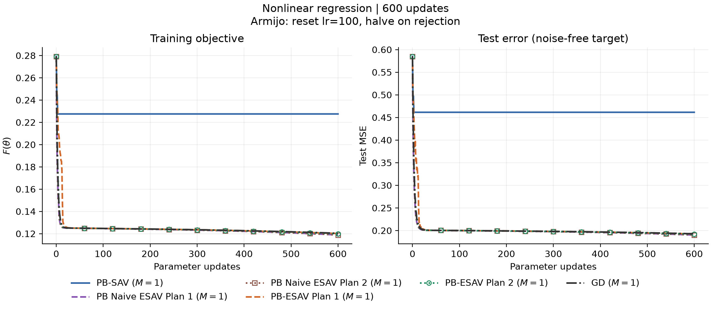
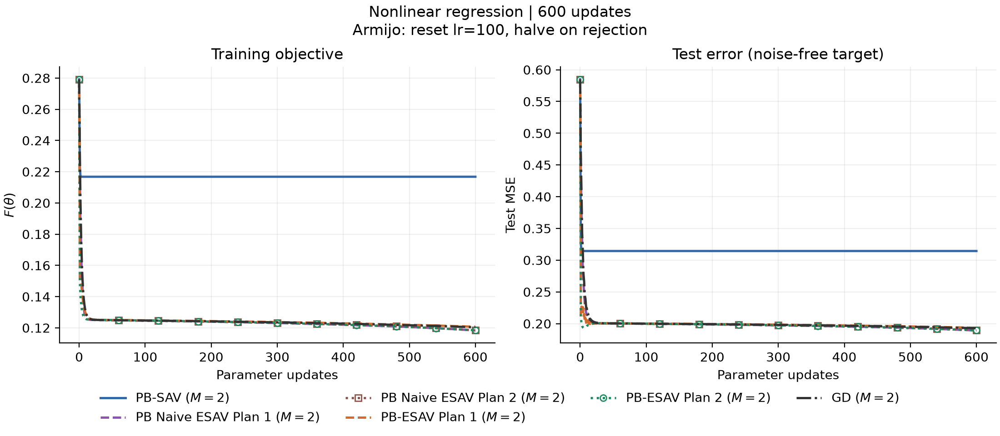
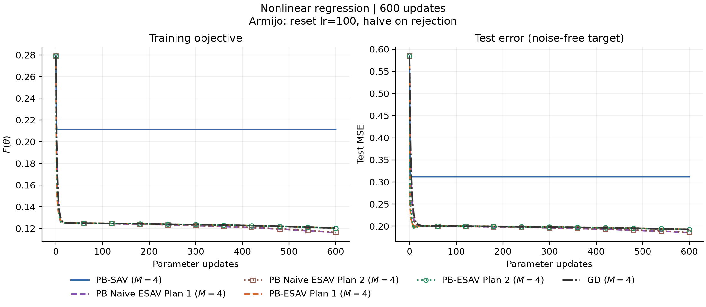
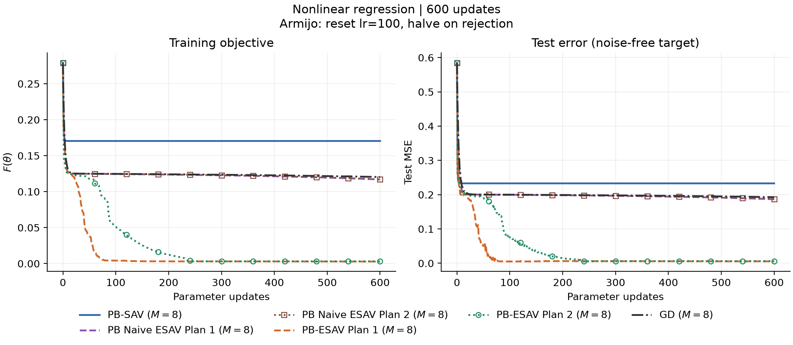
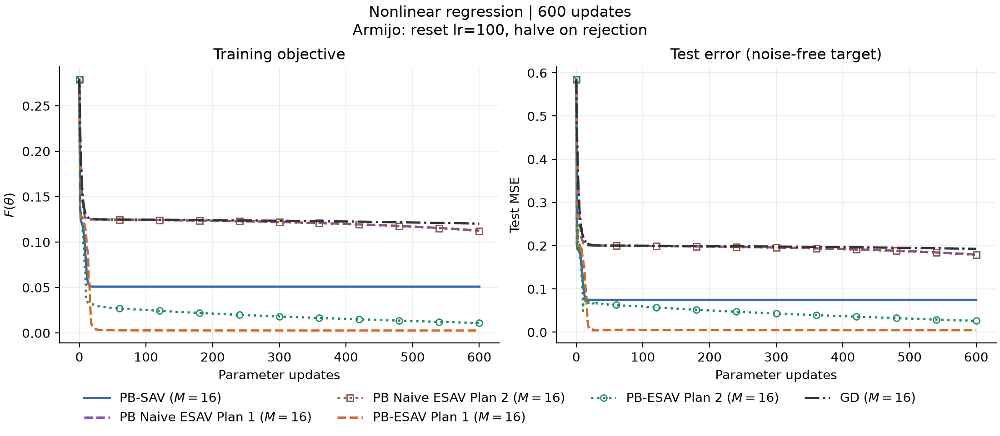
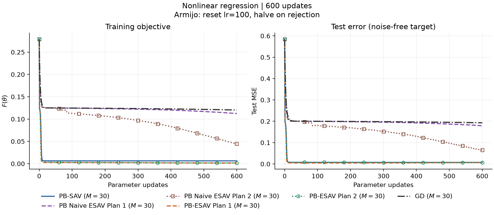

# Nonlinear Experiments Plan

## 目标函数

$$
\boxed{
\min_{\theta\in\mathbb{R}^{151}} F(\theta),
\qquad
F(\theta)=\frac{1}{2N}\sum_{i=1}^{N}
\bigl(f_\theta(x_i)-y_i\bigr)^2
}
$$

$$
\begin{aligned}
N&=30,\qquad x_i\in[0,1],\\
y_i&=\sin(2\pi x_i)+\varepsilon_i,
\qquad \varepsilon_i\overset{\mathrm{iid}}{\sim}\mathcal{N}(0,\sigma^2).
\end{aligned}
$$

## 神经网络

$$
\begin{aligned}
f_\theta(x)&=\sum_{j=1}^{50}c_j\tanh(a_jx+b_j)+b_0,\\
\theta&=(a,b,c,b_0),\qquad \dim\theta=50+50+50+1=151.
\end{aligned}
$$

## 对照目标

$$
\text{论文 PB-SAV}\;\longrightarrow\;\text{本地 PB-SAV}\;\longrightarrow\;\text{PB-ESAV}.
$$

| 论文基准 | $M$ | 接受的更新次数 | 最终训练目标 |
| --- | --- | --- | --- |
| [PB SAV Momentum §4.2, Table 2](PB_SAV_Momentum.pdf#page=21) | 30 | 600 | $2.525\times10^{-3}$ |

PB-ESAV 是本项目扩展。未取得作者代码；以下明确区分论文设置与用户批准的本地默认值。
原朴素实现现命名为 **PB-naiveESAV**（`pb_naive_esav`）；
局部辅助变量 $r_i=\exp(E_i+\frac12\ln(E_i+C/M))$ 的方案使用 **PB-ESAV**（`pb_esav`）。

## 固定超参数

| 配置入口 | 设置 |
| --- | --- |
| [problem/config.py](../problem/config.py) | `PROBLEMS["nonlinear_regression"]` |

| 参数 | 设置 | 依据 |
| --- | --- | --- |
| 样本数 / 区间 / 噪声 | $N=30$；$[0,1]$；$\sigma=0.1$ | 论文 §4.2 |
| 网络 | $1\to50\to1$；tanh；151 个参数 | 论文 §4.2 |
| Batch / 精度 | 全量；`float64` | 论文 §4 |
| 参数更新次数 | $K=600$；自适应方法只统计接受的更新 | 论文 §4.2 |
| Momentum | Off；direct update，$\alpha=1$ | 论文 §4.2 |
| 正则化 | $\lambda=0$ | 论文目标函数 |
| 训练点 | $x_i=(i-1)/29$ | 本地默认 |
| 测试点 | $x_\ell=\ell/1000$；$\ell=0,\ldots,1000$ | 本地默认 |
| 测试目标 | $\sin(2\pi x)$，无噪声 | 论文 §4.2 |
| 隐藏层初始化 | $a_j,b_j\sim\mathcal U(-1,1)$ | 本地默认 |
| 输出层初始化 | $c_j,b_0\sim\mathcal U(-1/\sqrt{50},1/\sqrt{50})$ | 本地默认 |
| 数据 / 初始化 / 分组种子 | 1 / 2 / 3 | 本地默认 |
| SAV / PB-SAV shift | $C=10^{-10}$；$C_k=C/M$ | 本地默认；论文 §4.2 未给数值 |
| PB-ESAV 辅助变量 | $r=\exp(E)$；$r_i=\exp(E_i+\frac12\ln(E_i+C/M))$，$C=10^{-10}$ | 本项目方案 |
| PB-ESAV 曲率权重 | $1+1/[2(E_i+C/M)]$ | 局部对数导数及指数的一阶展开 |
| PB-naiveESAV / GD shift | 无 | 本项目定义 |
| Relax | Off | 沿用项目设置；论文 §4.2 未明确该开关 |
| 设备 | CPU | 本地设置；论文为 A100 GPU |

## 自适应学习率与 Armijo

$$
\Delta\theta_k(\eta)\;\text{由对应优化器按学习率 }\eta\text{ 计算},
\qquad g_k=\nabla F(\theta_k).
$$

$$
\boxed{
 g_k^\mathsf T\Delta\theta_k(\eta)\leq0,\qquad
 F(\theta_k+\Delta\theta_k(\eta))
 \leq F(\theta_k)+c\,g_k^\mathsf T\Delta\theta_k(\eta)
}
$$

| 设置 | GD / PB-SAV / PB-naiveESAV / PB-ESAV | 依据 |
| --- | --- | --- |
| 学习率范围 | $10^{-6}\leq\eta\leq100$ | 六组方法统一设置 |
| 每轮初始学习率 | $\eta\leftarrow100$；与上一轮接受值无关 | 当前回溯规则 |
| Armijo 系数 | $c=10^{-4}$ | 用户批准的常规设置 |
| 拒绝后重试 | $\eta\leftarrow\max(0.5\eta,10^{-6})$；重新计算 $\Delta\theta_k(\eta)$ | 当前回溯规则 |
| 接受后 | $\theta_{k+1}=\theta_k+\Delta\theta_k(\eta)$；提交对应辅助变量 | 原优化器完整更新 |
| 拒绝的试探步 | 恢复 $\theta_k$；保留原辅助变量；不计入 $K$ | 接受／拒绝实现 |
| 下限 | $\eta=10^{-6}$ 仍被拒绝则报错，保留已接受记录 | 实现约定 |
| GD 更新 | $\Delta\theta_k(\eta)=-\eta g_k$ | 使用相同 Armijo 回溯 |

## 控制变量与能量分组

$$
\mathcal M=\{1,2,4,8,16,30\},\qquad
\begin{aligned}
\mathcal A=\{&\mathrm{PB\text{-}SAV},
\mathrm{PB\text{-}naiveESAV\ Plan\ 1},\mathrm{PB\text{-}naiveESAV\ Plan\ 2},\\
&\mathrm{PB\text{-}ESAV\ Plan\ 1},\mathrm{PB\text{-}ESAV\ Plan\ 2},\mathrm{GD}\}.
\end{aligned}
$$

$$
E_k(\theta)=\frac1{2N}\sum_{i\in G_k}(f_\theta(x_i)-y_i)^2,
\qquad F(\theta)=\sum_{k=1}^M E_k(\theta).
$$

| 分组 | 设置 |
| --- | --- |
| 论文要求 | 嵌套随机分组；$M=30$ 时每组一个样本 |
| 本地具体规则 | 种子 3 生成样本排列；依次二分最大组，直到得到 $M$ 组 |
| 可复建记录 | `config.json` 保存 `partition_seed` 和 `group_indices` |
| 对比范围 | 每个 $M\in\mathcal M$ 均比较六组方法 |

## 实验结果：M = 1

| 方法 | 最终训练目标 $F$ | 最终测试 MSE | 拒绝试探总数 | 接受的学习率范围 |
| --- | --- | --- | --- | --- |
| PB-SAV | $2.274832514\times10^{-1}$ | $4.613763738\times10^{-1}$ | 12 | $[0.390625,100]$ |
| PB-naiveESAV Plan 1 | $1.187831012\times10^{-1}$ | $1.902436951\times10^{-1}$ | 5038 | $[0.1953125,0.78125]$ |
| PB-naiveESAV Plan 2 | $1.187831012\times10^{-1}$ | $1.902436951\times10^{-1}$ | 5038 | $[0.1953125,0.78125]$ |
| PB-ESAV Plan 1 | $1.201162212\times10^{-1}$ | $1.924991628\times10^{-1}$ | 2328 | $[0.78125,100]$ |
| PB-ESAV Plan 2 | $1.198259576\times10^{-1}$ | $1.919566668\times10^{-1}$ | 4646 | $[0.390625,0.78125]$ |
| GD | $1.203258764\times10^{-1}$ | $1.928333337\times10^{-1}$ | 5349 | $[0.1953125,0.390625]$ |

## 实验结果：M = 2

| 方法 | 最终训练目标 $F$ | 最终测试 MSE | 拒绝试探总数 | 接受的学习率范围 |
| --- | --- | --- | --- | --- |
| PB-SAV | $2.167684229\times10^{-1}$ | $3.143856003\times10^{-1}$ | 0 | $[100,100]$ |
| PB-naiveESAV Plan 1 | $1.182679391\times10^{-1}$ | $1.892907013\times10^{-1}$ | 4972 | $[0.1953125,0.78125]$ |
| PB-naiveESAV Plan 2 | $1.184271494\times10^{-1}$ | $1.897176079\times10^{-1}$ | 4979 | $[0.1953125,0.78125]$ |
| PB-ESAV Plan 1 | $1.206734918\times10^{-1}$ | $1.934284871\times10^{-1}$ | 4731 | $[0.390625,100]$ |
| PB-ESAV Plan 2 | $1.184106383\times10^{-1}$ | $1.895442054\times10^{-1}$ | 4976 | $[0.1953125,100]$ |
| GD | $1.203258764\times10^{-1}$ | $1.928333337\times10^{-1}$ | 5349 | $[0.1953125,0.390625]$ |

## 实验结果：M = 4

| 方法 | 最终训练目标 $F$ | 最终测试 MSE | 拒绝试探总数 | 接受的学习率范围 |
| --- | --- | --- | --- | --- |
| PB-SAV | $2.112231673\times10^{-1}$ | $3.116563289\times10^{-1}$ | 0 | $[100,100]$ |
| PB-naiveESAV Plan 1 | $1.160201178\times10^{-1}$ | $1.857094333\times10^{-1}$ | 4884 | $[0.1953125,0.78125]$ |
| PB-naiveESAV Plan 2 | $1.164098738\times10^{-1}$ | $1.863835897\times10^{-1}$ | 4896 | $[0.1953125,0.78125]$ |
| PB-ESAV Plan 1 | $1.202661350\times10^{-1}$ | $1.928345934\times10^{-1}$ | 4720 | $[0.390625,100]$ |
| PB-ESAV Plan 2 | $1.201690426\times10^{-1}$ | $1.927241598\times10^{-1}$ | 4636 | $[0.390625,100]$ |
| GD | $1.203258764\times10^{-1}$ | $1.928333337\times10^{-1}$ | 5349 | $[0.1953125,0.390625]$ |

## 实验结果：M = 8

| 方法 | 最终训练目标 $F$ | 最终测试 MSE | 拒绝试探总数 | 接受的学习率范围 |
| --- | --- | --- | --- | --- |
| PB-SAV | $1.704238631\times10^{-1}$ | $2.330055750\times10^{-1}$ | 0 | $[100,100]$ |
| PB-naiveESAV Plan 1 | $1.168572436\times10^{-1}$ | $1.869842696\times10^{-1}$ | 4920 | $[0.1953125,0.78125]$ |
| PB-naiveESAV Plan 2 | $1.170055012\times10^{-1}$ | $1.872213126\times10^{-1}$ | 4931 | $[0.1953125,0.78125]$ |
| PB-ESAV Plan 1 | $2.815814043\times10^{-3}$ | $5.466548459\times10^{-3}$ | 3506 | $[0.78125,100]$ |
| PB-ESAV Plan 2 | $3.081069787\times10^{-3}$ | $6.223201210\times10^{-3}$ | 4093 | $[0.390625,100]$ |
| GD | $1.203258764\times10^{-1}$ | $1.928333337\times10^{-1}$ | 5349 | $[0.1953125,0.390625]$ |

## 实验结果：M = 16

| 方法 | 最终训练目标 $F$ | 最终测试 MSE | 拒绝试探总数 | 接受的学习率范围 |
| --- | --- | --- | --- | --- |
| PB-SAV | $5.098776875\times10^{-2}$ | $7.469416430\times10^{-2}$ | 2 | $[50,100]$ |
| PB-naiveESAV Plan 1 | $1.126629639\times10^{-1}$ | $1.796739246\times10^{-1}$ | 4823 | $[0.1953125,1.5625]$ |
| PB-naiveESAV Plan 2 | $1.122784692\times10^{-1}$ | $1.790513519\times10^{-1}$ | 4829 | $[0.1953125,1.5625]$ |
| PB-ESAV Plan 1 | $2.669282383\times10^{-3}$ | $4.728582211\times10^{-3}$ | 3636 | $[0.78125,100]$ |
| PB-ESAV Plan 2 | $1.097032059\times10^{-2}$ | $2.624515687\times10^{-2}$ | 342 | $[3.125,100]$ |
| GD | $1.203258764\times10^{-1}$ | $1.928333337\times10^{-1}$ | 5349 | $[0.1953125,0.390625]$ |

## 实验结果：M = 30

| 方法 | 最终训练目标 $F$ | 最终测试 MSE | 拒绝试探总数 | 接受的学习率范围 |
| --- | --- | --- | --- | --- |
| PB-SAV | $6.387098788\times10^{-3}$ | $7.311415189\times10^{-3}$ | 8 | $[25,100]$ |
| PB-naiveESAV Plan 1 | $1.123444538\times10^{-1}$ | $1.793724985\times10^{-1}$ | 4814 | $[0.1953125,1.5625]$ |
| PB-naiveESAV Plan 2 | $4.455623483\times10^{-2}$ | $6.485945268\times10^{-2}$ | 4930 | $[0.1953125,100]$ |
| PB-ESAV Plan 1 | $1.584532498\times10^{-3}$ | $6.655487505\times10^{-3}$ | 0 | $[100,100]$ |
| PB-ESAV Plan 2 | $1.687399816\times10^{-3}$ | $6.342293022\times10^{-3}$ | 0 | $[100,100]$ |
| GD | $1.203258764\times10^{-1}$ | $1.928333337\times10^{-1}$ | 5349 | $[0.1953125,0.390625]$ |

论文参考：[PB-SAV，§4.2，Table 2](PB_SAV_Momentum.pdf#page=21)，$M=30$、600 次更新，最终训练目标为 $2.525\times10^{-3}$。

## Inverse SAV

| 超参数 | 设置 |
| --- | --- |
| 网络 / 参数维数 | 1 → 50 → 1，tanh / 151 |
| 分量数 $M$ | 1、15、30（分别运行） |
| 参数更新次数 | 600 |
| 主要对比学习率 | 固定 100 |
| SGD / AdamW 补充参考学习率 | 固定 0.1 |
| Armijo / Relax | 关闭 / 关闭 |
| $C$ | $10^{-10}$ |
| 训练 / 测试样本数 | 30 / 1001 |
| 训练噪声标准差 / 种子 | 0.1 / 1 |
| 网络初始化种子 | 2 |
| 分组 / 种子 | 嵌套随机二分 / 3 |
| AdamW | betas=(0.9,0.999)，eps=$10^{-8}$，weight_decay=0 |
| 设备 / 精度 / Torch 线程数 | CPU / float64 / 1 |

### M = 30

| 方法 | 固定学习率 | 最终训练目标 | 最终测试 MSE | 辅助能量上升次数 |
| --- | ---: | ---: | ---: | ---: |
| PB-Inverse SAV | 100 | $4.16128952\times10^{-3}$ | $9.45733436\times10^{-3}$ | 0 |
| PB-SAV | 100 | $6.38709879\times10^{-3}$ | $7.31141519\times10^{-3}$ | 0 |
| SGD | 100 | 第 42 步失效 | — | — |
| AdamW | 100 | $2.39348773\times10^{-1}$ | $4.99643885\times10^{-1}$ | — |
| SGD | 0.1 | $1.23621123\times10^{-1}$ | $1.98212992\times10^{-1}$ | — |
| AdamW | 0.1 | $2.48969834\times10^{-3}$ | $5.00371761\times10^{-3}$ | — |

### M = 1

| 分组参数 | 设置 |
| --- | --- |
| 分量数 $M$ | 1 |
| 各组样本数 | 1 组 × 30 |

| 方法 | 固定学习率 | 最终训练目标 | 最终测试 MSE | 辅助能量上升次数 |
| --- | ---: | ---: | ---: | ---: |
| PB-Inverse SAV | 100 | $1.28957582\times10^{-2}$ | $2.21381049\times10^{-2}$ | 0 |
| PB-SAV | 100 | $7.86983534\times10^{-1}$ | $1.53746090$ | 0 |
| SGD | 100 | 第 42 步失效 | — | — |
| AdamW | 100 | $2.39348773\times10^{-1}$ | $4.99643885\times10^{-1}$ | — |
| SGD | 0.1 | $1.23621123\times10^{-1}$ | $1.98212992\times10^{-1}$ | — |
| AdamW | 0.1 | $2.48969834\times10^{-3}$ | $5.00371761\times10^{-3}$ | — |

### M = 15

| 分组参数 | 设置 |
| --- | --- |
| 分量数 $M$ | 15 |
| 各组样本数 | 13 组 × 2，1 组 × 1，1 组 × 3 |

| 方法 | 固定学习率 | 最终训练目标 | 最终测试 MSE | 辅助能量上升次数 |
| --- | ---: | ---: | ---: | ---: |
| PB-Inverse SAV | 100 | $4.53229682\times10^{-3}$ | $8.63060077\times10^{-3}$ | 0 |
| PB-SAV | 100 | $5.17329943\times10^{-2}$ | $7.59098028\times10^{-2}$ | 0 |
| SGD | 100 | 第 42 步失效 | — | — |
| AdamW | 100 | $2.39348773\times10^{-1}$ | $4.99643885\times10^{-1}$ | — |
| SGD | 0.1 | $1.23621123\times10^{-1}$ | $1.98212992\times10^{-1}$ | — |
| AdamW | 0.1 | $2.48969834\times10^{-3}$ | $5.00371761\times10^{-3}$ | — |

