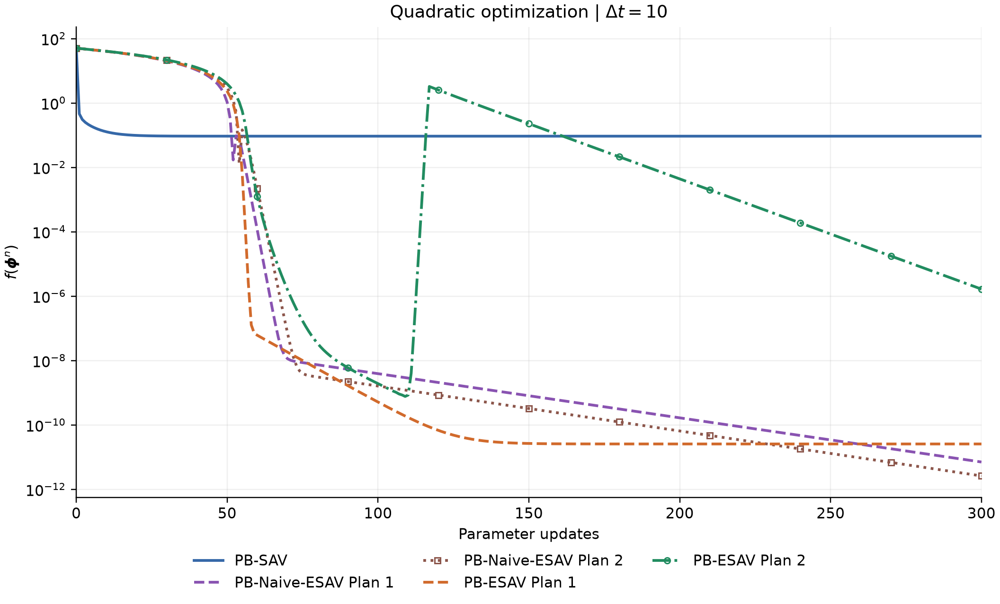
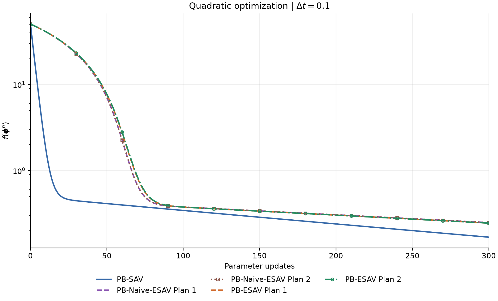
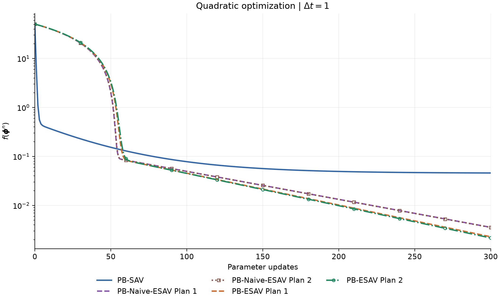

# Quadratic Experiment

## 目标函数

$$
\boxed{
\min_{\boldsymbol{\phi}\in\mathbb{R}^{100}} f(\boldsymbol{\phi}),
\qquad
f(\boldsymbol{\phi})
=\sum_{k=1}^{50}\phi_{2k-1}^{2}
+\frac{1}{100}\sum_{k=1}^{50}\phi_{2k}^{2}
}
$$

$$
\boldsymbol{\phi}^{\ast}=\boldsymbol{0},
\qquad f(\boldsymbol{\phi}^{\ast})=0.
$$

## 超参数

| 参数 | 设置 |
| --- | --- |
| 初值 | $\boldsymbol{\phi}^{0}=(1,\ldots,1)$；$f(\boldsymbol{\phi}^{0})=50.5$ |
| 更新次数 | $K=300$ |
| 总 shift | $C=10^{-10}$ |
| 正则化 | $\lambda=0$ |

## 能量分割
$$
\begin{aligned}
E_1(\boldsymbol{\phi})&=\sum_{k=1}^{50}\phi_{2k-1}^{2},\\
E_2(\boldsymbol{\phi})&=\frac{1}{100}\sum_{k=1}^{50}\phi_{2k}^{2},\\
f(\boldsymbol{\phi})&=E_1(\boldsymbol{\phi})+E_2(\boldsymbol{\phi}).
\end{aligned}
$$

| 实验项 | SAV 基线 |
| --- | --- |
| 方法 | SAV |
| 能量 | $E_1+E_2$ |
| 分量数 | $M=1$ |
## 实验表格

### $\Delta t=10$

| 方法 | 最终目标 $f(\boldsymbol{\phi}^{300})$ |
| --- | --- |
| PB-SAV | $9.308350881\times10^{-2}$ |
| PB-Naive-ESAV Plan 1 | $7.055851969\times10^{-12}$ |
| PB-Naive-ESAV Plan 2 | $2.610606321\times10^{-12}$ |
| PB-ESAV Plan 1 | $2.563976083\times10^{-11}$ |
| PB-ESAV Plan 2 | $1.655841109\times10^{-6}$ |

### $\Delta t=0.1$

| 方法 | 最终目标 $f(\boldsymbol{\phi}^{300})$ |
| --- | --- |
| PB-SAV | $1.687650689\times10^{-1}$ |
| PB-Naive-ESAV Plan 1 | $2.491615377\times10^{-1}$ |
| PB-Naive-ESAV Plan 2 | $2.492495415\times10^{-1}$ |
| PB-ESAV Plan 1 | $2.459861381\times10^{-1}$ |
| PB-ESAV Plan 2 | $2.457434468\times10^{-1}$ |

### $\Delta t=1$

| 方法 | 最终目标 $f(\boldsymbol{\phi}^{300})$ |
| --- | --- |
| PB-SAV | $4.597651866\times10^{-2}$ |
| PB-Naive-ESAV Plan 1 | $3.572298599\times10^{-3}$ |
| PB-Naive-ESAV Plan 2 | $3.550239817\times10^{-3}$ |
| PB-ESAV Plan 1 | $2.289379497\times10^{-3}$ |
| PB-ESAV Plan 2 | $2.167517990\times10^{-3}$ |

## 诊断实验

### ESAV验证

| 参数 | 设置 |
| --- | --- |
| 学习率 | $1$ |
| 更新次数 | $300$ |
| 梯度 | 全量 |
| SGD momentum / weight_decay | $0$ / $0$ |
| AdamW betas | $(0.9, 0.999)$ |
| AdamW eps / weight_decay | $10^{-8}$ / $0$ |

| 方法 | 分量数 | 最终目标 $f(\boldsymbol{\phi}^{300})$ |
| --- | --- | --- |
| SGD | 1 | $5.000000272\times10^{1}$ |
| AdamW | 1 | $3.747136635\times10^{-13}$ |
| SAV | 1 | $9.194173800\times10^{-2}$ |
| ESAV | 1 | $5.048020000\times10^{1}$ |
| ESAV（r 更新指数的一阶近似） | 1 | $8.282451441\times10^{6}$ |
| PB-Naive-ESAV Plan 1 | 2 | $3.572298599\times10^{-3}$ |
| PB-Naive-ESAV Plan 2 | 2 | $3.550239817\times10^{-3}$ |

| 方法 | $r^1/\exp(E(x^1))$ | $r^{300}/\exp(E(x^{300}))$ | $r<0$ 的记录数 |
| --- | --- | --- | --- |
| ESAV | $1.383619775\times10^{-87}$ | $1.383619775\times10^{-87}$ | 0 |
| ESAV（r 更新指数的一阶近似） | $-2.029998667\times10^{2}$ | $0$ | 1 |

