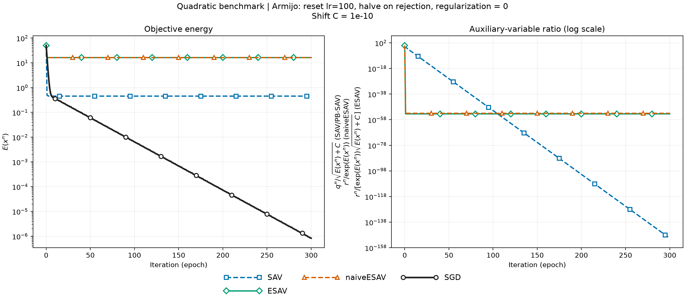
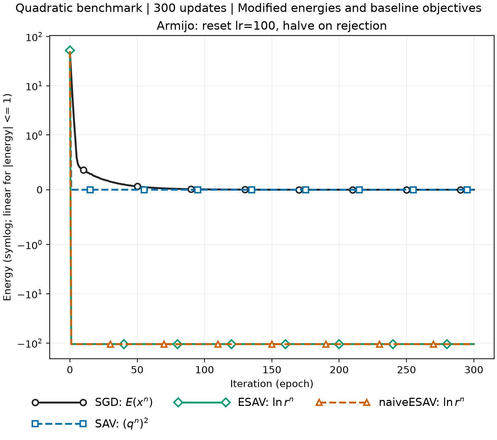

# Validation

$$
\min_{x\in\mathbb{R}^{100}} E(x),
\qquad
E(x)=\sum_{k=1}^{50}x_{2k-1}^{2}
+\frac{1}{100}\sum_{k=1}^{50}x_{2k}^{2}.
$$

$$
x^{\ast}=0,\qquad E(x^{\ast})=0.
$$

## 超参数

| 参数 | 设置 |
| --- | --- |
| 对比方法 | SAV、ESAV、naiveESAV、SGD |
| 维度、初值 | $100$，$x^0=(1,\ldots,1)$ |
| 初始目标 | $E(x^0)=50.5$ |
| 接受更新次数 | $300$ |
| 每轮初始学习率 | $100$ |
| 回溯缩减因子 | $0.5$ |
| 最低试探学习率 | $10^{-6}$ |
| Armijo 系数 | $10^{-4}$ |
| Armijo 条件 | $E(x^{n+1})\le E(x^n)+10^{-4}\nabla E(x^n)^\top(x^{n+1}-x^n)$ |
| 方向条件 | $\nabla E(x^n)^\top(x^{n+1}-x^n)\le0$ |
| 拒绝试探步 | 参数与辅助状态回滚；缩减学习率后重算；不计入接受次数 |
| SAV / ESAV shift | $C=10^{-10}$ |
| SAV 初始化 | $r^0=\sqrt{E(x^0)+C}$ |
| ESAV 初始化 | $\log r^0=E(x^0)+\frac12\log(E(x^0)+C)$ |
| naiveESAV 初始化 | $\log r^0=E(x^0)$ |
| Relax / 指数一阶展开 | Off / Off |
| 能量分量数、正则化 | $M=1$，$\lambda=0$ |
| SGD 动量、权重衰减 | $0,\ 0$ |
| 梯度、设备、精度 | 全量梯度、CPU、float64 |

## 结果

| 方法 | $E(x^{300})$ | 接受次数 | 目标严格下降次数（float64） | 拒绝次数 | 接受学习率范围 |
| --- | ---: | ---: | ---: | ---: | --- |
| SAV | $4.53719836\times10^{-1}$ | 300 | 30 | 0 | $[100,100]$ |
| ESAV | $1.63048096\times10^{1}$ | 300 | 1 | 7 | $[0.78125,100]$ |
| naiveESAV | $1.63048096\times10^{1}$ | 300 | 1 | 7 | $[0.78125,100]$ |
| SGD | $8.35462161\times10^{-7}$ | 300 | 300 | 1978 | $[0.78125,1.5625]$ |

| 方法 | 修正能量（第 300 步） | 一致性比值定义 | 第 300 步比值 |
| --- | --- | --- | ---: |
| SAV | $(r^{300})^2=4.73524142\times10^{-302}$ | $r^n/\sqrt{E(x^n)+C}$ | $3.23055530\times10^{-151}$ |
| ESAV | $\log r^{300}=-105.35182274$ | $r^n/[e^{E(x^n)}\sqrt{E(x^n)+C}]$ | $3.62274726\times10^{-54}$ |
| naiveESAV | $\log r^{300}=-105.765625$ | $r^n/e^{E(x^n)}$ | $9.67127790\times10^{-54}$ |

## 曲线

