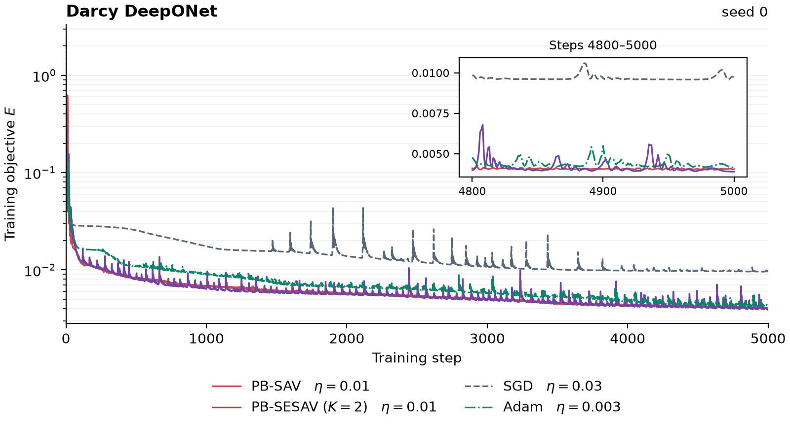
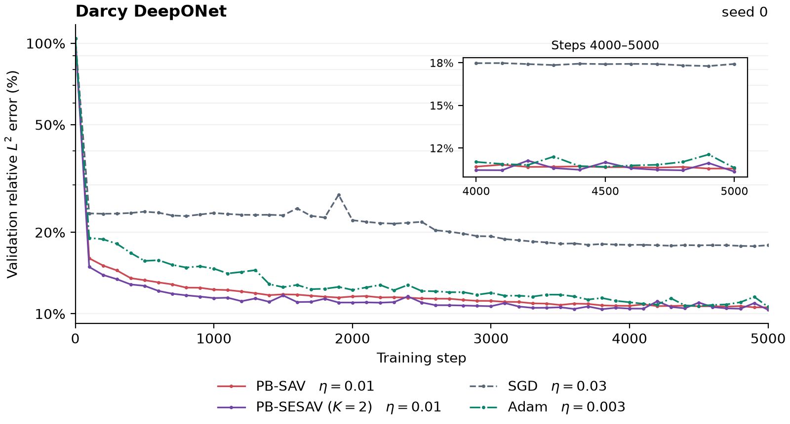

# Darcy DeepONet 上的 PB-SESAV 动量对照

四种方法使用同一组 Darcy 数据（数据种子 20261106）和相同的 DeepONet 初始权重（种子 0）。训练总目标 $E$ 为归一化数据损失与 L2 正则项之和。验证误差每 100 步计算一次，取 32 个验证场各自相对 $L^2$ 误差的平均值。

| 方法 | 固定学习率 | 第 5000 步训练总目标 $E$ | 第 5000 步验证相对 $L^2$ 误差 |
| --- | ---: | ---: | ---: |
| PB-SAV | 0.01 | 0.004038 | 10.56% |
| PB-SESAV（$K=2$） | 0.01 | 0.003885 | 10.34% |
| SGD（动量 0.9） | 0.03 | 0.009717 | 17.92% |
| Adam | 0.003 | 0.004146 | 10.60% |

两种 PB 方法均采用动量 0.9、PB 系数 0.5、AMSGrad 和完全 Relax。PB-SAV 后期更平稳，PB-SESAV 的最终训练总目标低 3.79%。同一 PB-SESAV 配置在初始化种子 42 下停滞，最终 $E=68.24$。

