# ESAV 及其扩展的数值实验

验证 ESAV 在二次型与非线性回归中的优化表现，并考察 PB、Relax 与动量扩展。

$$
\text{SAV}:\ r=\sqrt{E+C},\qquad \text{ESAV}:\ r=\exp\!\left(\frac{E}{4E^0}\right),\qquad E^0=E(\theta^0)>0\ \text{冻结}.
$$

## 共同参数与评价指标

| 参数 | 二次型 | 非线性回归 |
| --- | --- | --- |
| 更新预算 | $K=300$ | $K=600$ |
|  |
|  |
|  |
| 数据与初值 | $\theta^0=(1,\ldots,1)\in\mathbb R^{100}$ | $N=30$；$[0,1]$ 等距采样；噪声标准差 $0.1$，种子 1 |
| 网络与初始化 | 直接优化参数 | $1\to50\to1$，tanh；初始化种子 2 |
| PB 分组 | 奇数与偶数坐标，$M=2$ | 嵌套随机分组，种子 3；$M=2,4,8,16,30$ |
| SAV shift | $C=10^{-10}$ | $C=10^{-10}$ |
|  |

$$
\begin{aligned}
\text{二次型：}\quad
f(\theta)&=\sum_{k=1}^{50}\theta_{2k-1}^2
+\frac1{100}\sum_{k=1}^{50}\theta_{2k}^2,\\
\text{非线性：}\quad
E(\theta)&=\frac1{2N}\sum_{j=1}^{N}
\bigl(u_\theta(x_j)-y_j\bigr)^2,\qquad
y_j=\sin(2\pi x_j)+\varepsilon_j,\quad
\varepsilon_j\sim\mathcal N(0,0.1^2).
\end{aligned}
$$

| 对照条件 | 设置 |
| --- | --- |
| A–D 的 SAV、ESAV、PB 与 SGD | Armijo：每轮从 100 开始，收缩因子 0.5，下限 $10^{-6}$，$c=10^{-4}$ |
| AdamW | 固定学习率 0.1；$\beta_1=0.9,\beta_2=0.999,\epsilon=10^{-8}$；weight decay 为 0 |
| E 的动量方法 | 固定学习率 0.1；动量系数 0.9，$\alpha=0.5$，缩放矩阵 $I$；完全 Relax 的 $\rho=1$ |
| |

## A 二次型基础方法

$M=1$，$K=300$；比较辅助变量形式及 Relax。AdamW 作为固定学习率参考。

### A1 基础 ESAV 与 Relax

| 方法与原始记录 | Relax | 学习率 | 最终目标 |
| --- | --- | --- | --- |
| [SAV](https://forge.coreweave.com/wandb/pheonizard-university-of-nottingham/NumericalScheme/runs/20c9bc28cfa3) | 关 | Armijo | $4.537198\times10^{-1}$ ‡ |
| [ESAV](https://forge.coreweave.com/wandb/pheonizard-university-of-nottingham/NumericalScheme/runs/bbac1a11c98c) | 关 | Armijo | $5.842314\times10^{-7}$ |
| [SAV](https://forge.coreweave.com/wandb/pheonizard-university-of-nottingham/NumericalScheme/runs/640958e349a7) | 开 | Armijo | $6.397809\times10^{-7}$ |
| [ESAV](https://forge.coreweave.com/wandb/pheonizard-university-of-nottingham/NumericalScheme/runs/df873b70f847) | 开 | Armijo | $8.354622\times10^{-7}$ |
| [SGD](https://forge.coreweave.com/wandb/pheonizard-university-of-nottingham/NumericalScheme/runs/81cd960259c2) | 关 | Armijo | $8.354622\times10^{-7}$ |
| [AdamW](https://forge.coreweave.com/wandb/pheonizard-university-of-nottingham/NumericalScheme/runs/8914085ecaec) | 关 | 固定 0.1 | $2.247304\times10^{-13}$ |

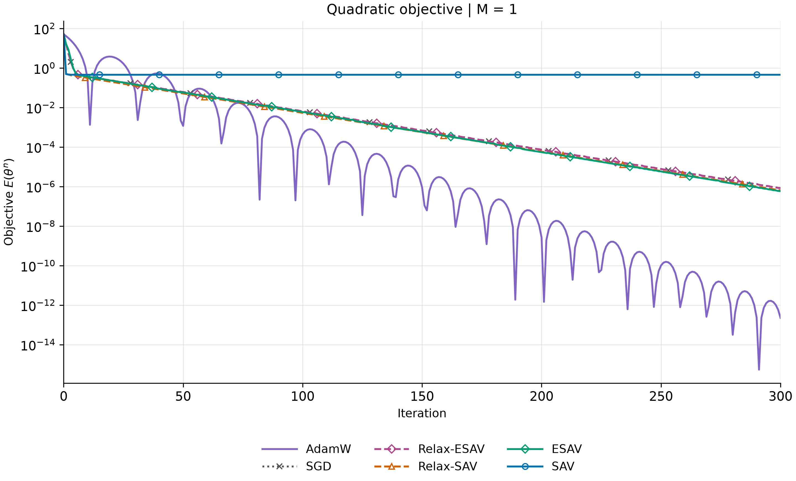

ESAV 持续下降，SAV 停滞；Relax-SAV 恢复下降，Relax-ESAV 与 SGD 的目标轨迹在浮点精度内重合。

## B 二次型 PB 扩展

$M=2$，$K=300$；Armijo。与 A1 的基础方法比较 PB 的作用，复用 A1 的 SGD、AdamW 基线。

### B1 PB 与 Relax 的组合

| 方法与原始记录 | Relax | 最终目标 |
| --- | --- | --- |
| [PB-SAV](https://forge.coreweave.com/wandb/pheonizard-university-of-nottingham/NumericalScheme/runs/1288824d6201) | 关 | $3.235567\times10^{-2}$ ‡ |
| [PB-ESAV](https://forge.coreweave.com/wandb/pheonizard-university-of-nottingham/NumericalScheme/runs/b6b4f3c6580c) | 关 | $8.282665\times10^{-39}$ |
| [PB-SAV](https://forge.coreweave.com/wandb/pheonizard-university-of-nottingham/NumericalScheme/runs/d3b4d07c7275) | 开 | $1.124140\times10^{-16}$ |
| [PB-ESAV](https://forge.coreweave.com/wandb/pheonizard-university-of-nottingham/NumericalScheme/runs/bfee6830c639) | 开 | $4.736856\times10^{-39}$ |

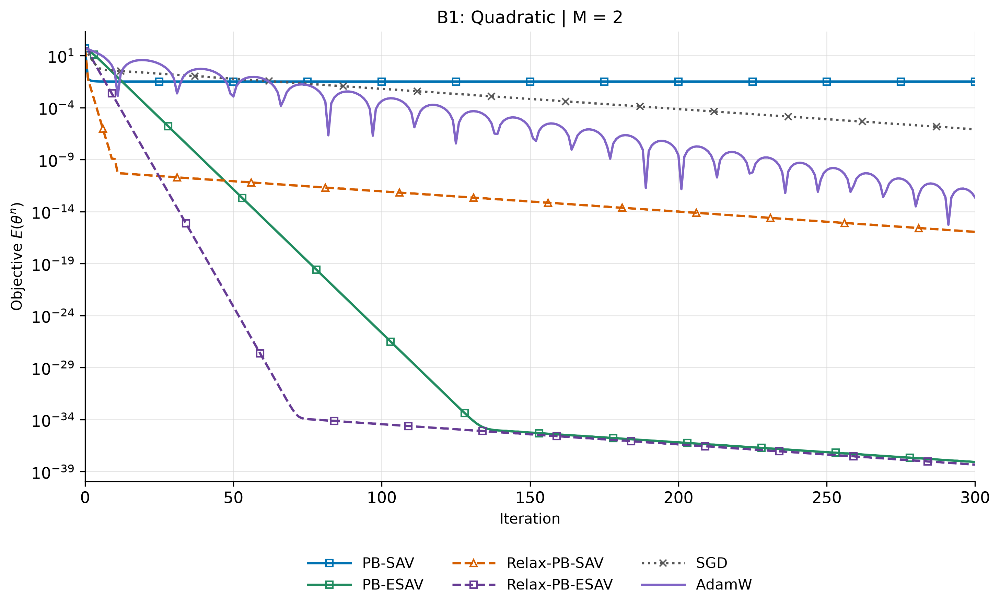

## C 非线性基础方法

$M=1$，$K=600$；与 A1 保持相同方法组合，检验结果能否延续到非线性优化。

### C1 基础 ESAV 的非线性表现

| 方法与原始记录 | Relax | 学习率 | 最终目标 |
| --- | --- | --- | --- |
| [SAV](https://forge.coreweave.com/wandb/pheonizard-university-of-nottingham/NumericalScheme/runs/98ab403b9a60) | 关 | Armijo | $2.274833\times10^{-1}$ ‡ |
| [ESAV](https://forge.coreweave.com/wandb/pheonizard-university-of-nottingham/NumericalScheme/runs/2977d4c255df) | 关 | Armijo | $1.185830\times10^{-1}$ |
| [SAV](https://forge.coreweave.com/wandb/pheonizard-university-of-nottingham/NumericalScheme/runs/748b782c7154) | 开 | Armijo | $1.204126\times10^{-1}$ |
| [ESAV](https://forge.coreweave.com/wandb/pheonizard-university-of-nottingham/NumericalScheme/runs/f394ef48a942) | 开 | Armijo | $1.203259\times10^{-1}$ |
| [SGD](https://forge.coreweave.com/wandb/pheonizard-university-of-nottingham/NumericalScheme/runs/b4caea89eaf7) | 关 | Armijo | $1.203259\times10^{-1}$ |
| [AdamW](https://forge.coreweave.com/wandb/pheonizard-university-of-nottingham/NumericalScheme/runs/a1d48545dfa6) | 关 | 固定 0.1 | $2.489698\times10^{-3}$ |

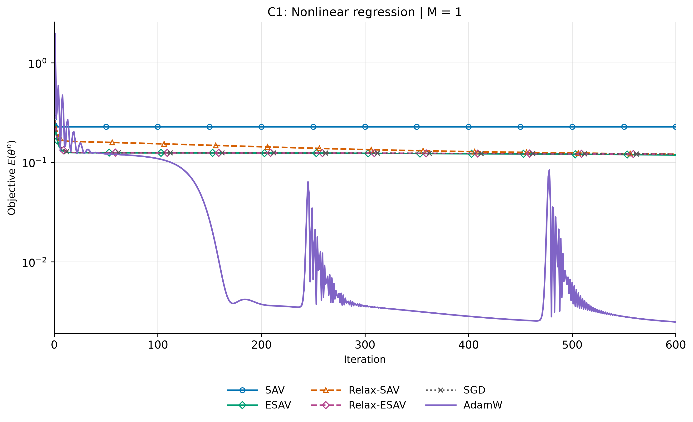

## D 非线性 PB 与 Relax

$K=600$；Armijo；每个 $M$ 固定数据、网络、初值与分组，对照四种组合。C1 的 SGD 与 AdamW 可作为各图共用基线。

### D1 分量数 2

| 方法与原始记录 | Relax | 最终目标 |
| --- | --- | --- |
| [PB-SAV](https://forge.coreweave.com/wandb/pheonizard-university-of-nottingham/NumericalScheme/runs/fbb4aad536d5) | 关 | $2.167684\times10^{-1}$ ‡ |
| [PB-ESAV](https://forge.coreweave.com/wandb/pheonizard-university-of-nottingham/NumericalScheme/runs/5c8532a1e995) | 关 | $1.179550\times10^{-1}$ |
| [PB-SAV](https://forge.coreweave.com/wandb/pheonizard-university-of-nottingham/NumericalScheme/runs/5ff770f6618c) | 开 | $1.207992\times10^{-1}$ |
| [PB-ESAV](https://forge.coreweave.com/wandb/pheonizard-university-of-nottingham/NumericalScheme/runs/bb4c930fc9d6) | 开 | $1.203632\times10^{-1}$ |

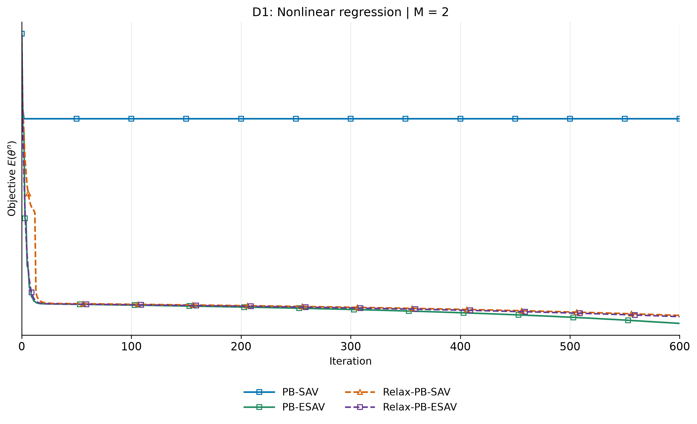

### D2 分量数 4

| 方法与原始记录 | Relax | 最终目标 |
| --- | --- | --- |
| [PB-SAV](https://forge.coreweave.com/wandb/pheonizard-university-of-nottingham/NumericalScheme/runs/908af20a4137) | 关 | $2.112232\times10^{-1}$ ‡ |
| [PB-ESAV](https://forge.coreweave.com/wandb/pheonizard-university-of-nottingham/NumericalScheme/runs/a1f98c1c8160) | 关 | $1.181725\times10^{-1}$ |
| [PB-SAV](https://forge.coreweave.com/wandb/pheonizard-university-of-nottingham/NumericalScheme/runs/42e98dfb423b) | 开 | $1.106565\times10^{-1}$ |
| [PB-ESAV](https://forge.coreweave.com/wandb/pheonizard-university-of-nottingham/NumericalScheme/runs/cfa7a3cc86c1) | 开 | $1.202907\times10^{-1}$ |

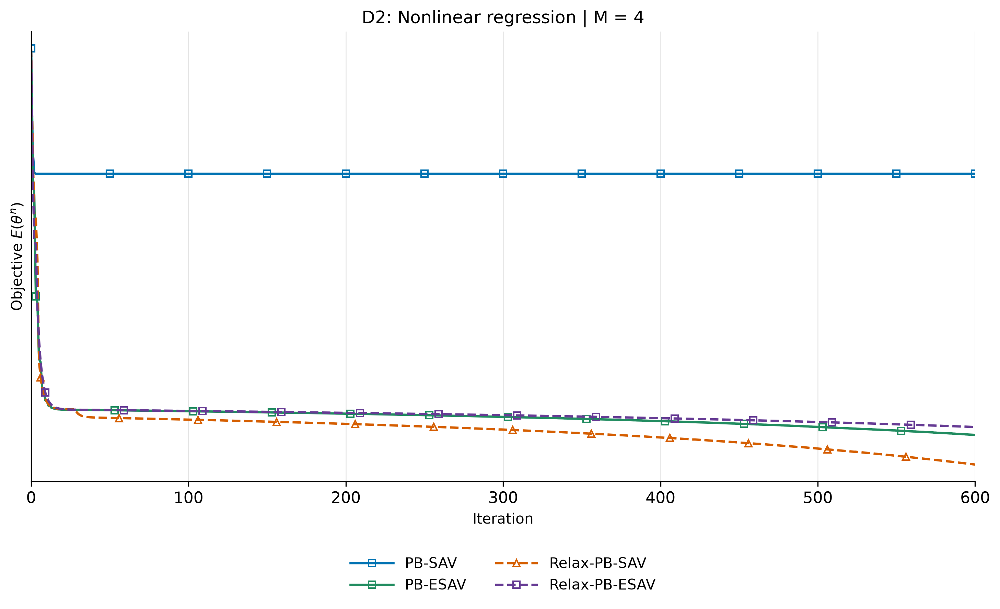

### D3 分量数 8

| 方法与原始记录 | Relax | 最终目标 |
| --- | --- | --- |
| [PB-SAV](https://forge.coreweave.com/wandb/pheonizard-university-of-nottingham/NumericalScheme/runs/eb2848ac1045) | 关 | $1.704239\times10^{-1}$ ‡ |
| [PB-ESAV](https://forge.coreweave.com/wandb/pheonizard-university-of-nottingham/NumericalScheme/runs/ddb3a1415a5c) | 关 | $1.192191\times10^{-1}$ |
| [PB-SAV](https://forge.coreweave.com/wandb/pheonizard-university-of-nottingham/NumericalScheme/runs/5987a9a61dd0) | 开 | $2.616874\times10^{-3}$ |
| [PB-ESAV](https://forge.coreweave.com/wandb/pheonizard-university-of-nottingham/NumericalScheme/runs/3a940eccc41a) | 开 | $1.196914\times10^{-1}$ |

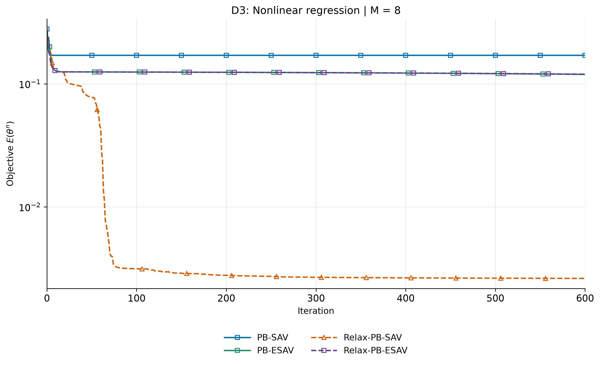

Relax-PB-SAV 达到 $2.62\times10^{-3}$，Relax-PB-ESAV 仍为 $1.20\times10^{-1}$；本组不支持 ESAV 在 Relax 后更优。

### D4 分量数 16

| 方法与原始记录 | Relax | 最终目标 |
| --- | --- | --- |
| [PB-SAV](https://forge.coreweave.com/wandb/pheonizard-university-of-nottingham/NumericalScheme/runs/c35d2e4e83fb) | 关 | $5.098777\times10^{-2}$ ‡ |
| [PB-ESAV](https://forge.coreweave.com/wandb/pheonizard-university-of-nottingham/NumericalScheme/runs/5ab903f3df71) | 关 | $1.455871\times10^{-2}$ |
| [PB-SAV](https://forge.coreweave.com/wandb/pheonizard-university-of-nottingham/NumericalScheme/runs/5eda45981333) | 开 | $2.524810\times10^{-3}$ |
| [PB-ESAV](https://forge.coreweave.com/wandb/pheonizard-university-of-nottingham/NumericalScheme/runs/58b1d468b5e6) | 开 | $7.449043\times10^{-3}$ |

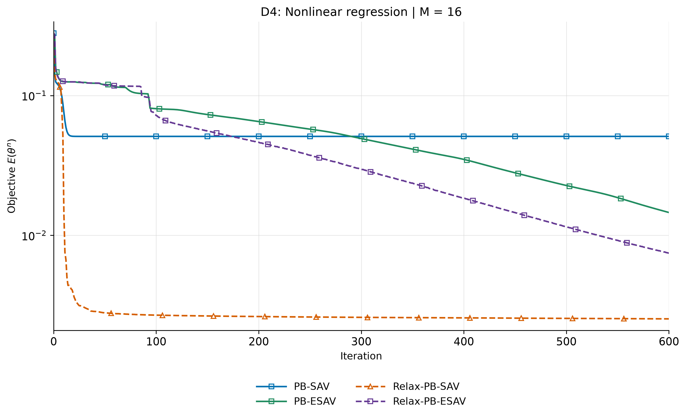

### D5 分量数 30

| 方法与原始记录 | Relax | 最终目标 |
| --- | --- | --- |
| [PB-SAV](https://forge.coreweave.com/wandb/pheonizard-university-of-nottingham/NumericalScheme/runs/40f912e75865) | 关 | $6.387099\times10^{-3}$ ‡ |
| [PB-ESAV](https://forge.coreweave.com/wandb/pheonizard-university-of-nottingham/NumericalScheme/runs/24ef5f8af31c) | 关 | $3.493109\times10^{-3}$ |
| [PB-SAV](https://forge.coreweave.com/wandb/pheonizard-university-of-nottingham/NumericalScheme/runs/00c28cf1a34e) | 开 | $1.572644\times10^{-3}$ |
| [PB-ESAV](https://forge.coreweave.com/wandb/pheonizard-university-of-nottingham/NumericalScheme/runs/c6bc56347ca7) | 开 | $3.124943\times10^{-3}$ |

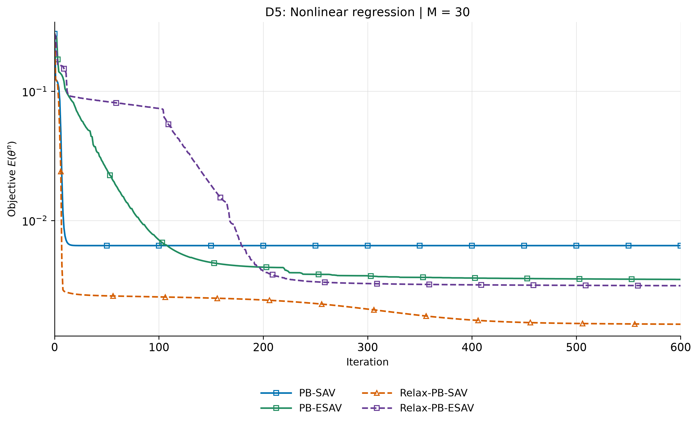

## E 非线性动量扩展

$K=600$；固定学习率 0.1，动量系数 0.9，$\alpha=0.5$，缩放矩阵 $I$。每组比较相同动量配置下的 SAV、ESAV 及其 Relax，并共用 SGD＋动量基线。

### E1 分量数 2

| 方法与原始记录 | Relax | 最终目标 |
| --- | --- | --- |
| [PB-SAV](https://forge.coreweave.com/wandb/pheonizard-university-of-nottingham/NumericalScheme/runs/f9a954df51ca) | 关 | $1.153312\times10^{-1}$ |
| [PB-ESAV](https://forge.coreweave.com/wandb/pheonizard-university-of-nottingham/NumericalScheme/runs/24019ed86d38) | 关 | $3.228674\times10^{-3}$ |
| [PB-SAV](https://forge.coreweave.com/wandb/pheonizard-university-of-nottingham/NumericalScheme/runs/83ec9760b0d1) | 开 | $3.126172\times10^{-3}$ |
| [PB-ESAV](https://forge.coreweave.com/wandb/pheonizard-university-of-nottingham/NumericalScheme/runs/de017e333e33) | 开 | $3.134695\times10^{-3}$ |
| [SGD＋动量](https://forge.coreweave.com/wandb/pheonizard-university-of-nottingham/NumericalScheme/runs/8cffc061330b) | — | $3.137466\times10^{-3}$ |

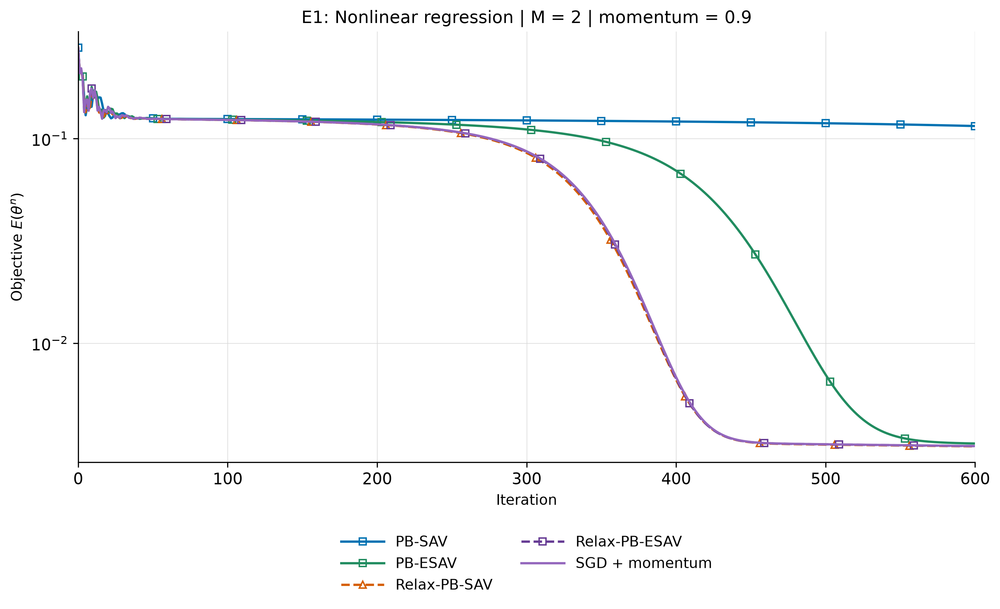

### E2 分量数 4

| 方法与原始记录 | Relax | 最终目标 |
| --- | --- | --- |
| [PB-SAV](https://forge.coreweave.com/wandb/pheonizard-university-of-nottingham/NumericalScheme/runs/a71e47e477d5) | 关 | $1.130872\times10^{-1}$ |
| [PB-ESAV](https://forge.coreweave.com/wandb/pheonizard-university-of-nottingham/NumericalScheme/runs/ec740acccad4) | 关 | $3.225909\times10^{-3}$ |
| [PB-SAV](https://forge.coreweave.com/wandb/pheonizard-university-of-nottingham/NumericalScheme/runs/311e0d1cde20) | 开 | $3.125702\times10^{-3}$ |
| [PB-ESAV](https://forge.coreweave.com/wandb/pheonizard-university-of-nottingham/NumericalScheme/runs/bd604d57dc43) | 开 | $3.134441\times10^{-3}$ |
| [SGD＋动量](https://forge.coreweave.com/wandb/pheonizard-university-of-nottingham/NumericalScheme/runs/8cffc061330b) | — | $3.137466\times10^{-3}$ |

### E3 分量数 8

| 方法与原始记录 | Relax | 最终目标 |
| --- | --- | --- |
| [PB-SAV](https://forge.coreweave.com/wandb/pheonizard-university-of-nottingham/NumericalScheme/runs/873df0bf8cc0) | 关 | $3.453054\times10^{-2}$ |
| [PB-ESAV](https://forge.coreweave.com/wandb/pheonizard-university-of-nottingham/NumericalScheme/runs/b6a804c7552a) | 关 | $3.199261\times10^{-3}$ |
| [PB-SAV](https://forge.coreweave.com/wandb/pheonizard-university-of-nottingham/NumericalScheme/runs/bae041585253) | 开 | $3.122640\times10^{-3}$ |
| [PB-ESAV](https://forge.coreweave.com/wandb/pheonizard-university-of-nottingham/NumericalScheme/runs/8eb0c036f0f1) | 开 | $3.132205\times10^{-3}$ |
| [SGD＋动量](https://forge.coreweave.com/wandb/pheonizard-university-of-nottingham/NumericalScheme/runs/8cffc061330b) | — | $3.137466\times10^{-3}$ |

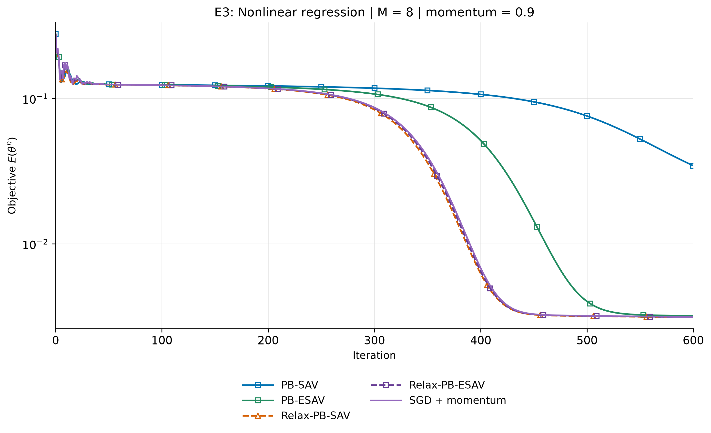
### E4 分量数 16

| 方法与原始记录 | Relax | 最终目标 |
| --- | --- | --- |
| [PB-SAV](https://forge.coreweave.com/wandb/pheonizard-university-of-nottingham/NumericalScheme/runs/a2c6a0a67046) | 关 | $1.886777\times10^{-2}$ |
| [PB-ESAV](https://forge.coreweave.com/wandb/pheonizard-university-of-nottingham/NumericalScheme/runs/877b3447b2c4) | 关 | $3.191682\times10^{-3}$ |
| [PB-SAV](https://forge.coreweave.com/wandb/pheonizard-university-of-nottingham/NumericalScheme/runs/0205570c823c) | 开 | $3.117632\times10^{-3}$ |
| [PB-ESAV](https://forge.coreweave.com/wandb/pheonizard-university-of-nottingham/NumericalScheme/runs/617ec7e64ea9) | 开 | $3.131021\times10^{-3}$ |
| [SGD＋动量](https://forge.coreweave.com/wandb/pheonizard-university-of-nottingham/NumericalScheme/runs/8cffc061330b) | — | $3.137466\times10^{-3}$ |

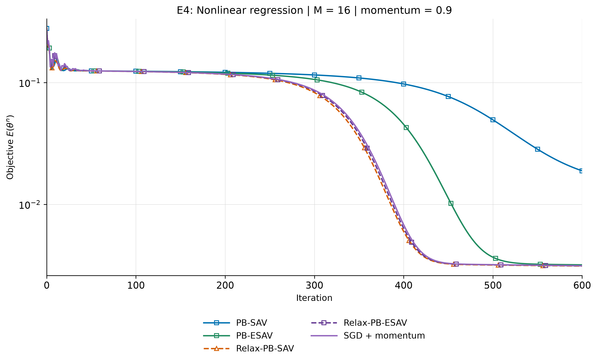

### E5 分量数 30

| 方法与原始记录 | Relax | 最终目标 |
| --- | --- | --- |
| [PB-SAV](https://forge.coreweave.com/wandb/pheonizard-university-of-nottingham/NumericalScheme/runs/b63e430be88d) | 关 | $7.379412\times10^{-3}$ |
| [PB-ESAV](https://forge.coreweave.com/wandb/pheonizard-university-of-nottingham/NumericalScheme/runs/6e7a8d07ccd9) | 关 | $2.828360\times10^{-3}$ |
| [PB-SAV](https://forge.coreweave.com/wandb/pheonizard-university-of-nottingham/NumericalScheme/runs/09b8192545ac) | 开 | $3.107371\times10^{-3}$ |
| [PB-ESAV](https://forge.coreweave.com/wandb/pheonizard-university-of-nottingham/NumericalScheme/runs/571db84cacda) | 开 | $2.777804\times10^{-3}$ |
| [SGD＋动量](https://forge.coreweave.com/wandb/pheonizard-university-of-nottingham/NumericalScheme/runs/8cffc061330b) | — | $3.137466\times10^{-3}$ |

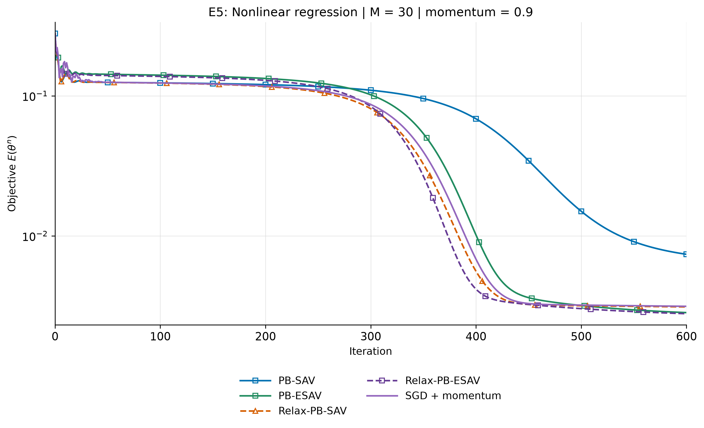
C1 的 AdamW 使用相同固定学习率 0.1，最终目标为 $2.489698\times10^{-3}$，可复用为参考。D 与 E 同时改变学习率策略、动量和 PB 强度，不能据此单独量化动量的贡献。

## 辅助变量与停滞诊断

$$
\text{SAV 辅助比值}=\frac{r^n}{\sqrt{E^n+C}},\qquad
\text{ESAV 辅助比值}=\frac{r^n}{\exp(E^n/(4E^0))}.
$$

| 问题 | $M$ | SAV 目标不变步数 | SAV 最终辅助比值 | ESAV 目标不变步数 | ESAV 最终辅助比值 |
| --- | --- | --- | --- | --- | --- |
| 二次型 | 1 | 270 | $3.230555\times10^{-151}$ | 0 | 0.471126 |
| 二次型 | 2 | 267 | $5.824034\times10^{-146}$ | 0 | 0.276417 |
| 非线性 | 1 | 591 | $8.201490\times10^{-322}$ | 0 | 0.729378 |
| 非线性 | 2 | 591 | $9.387247\times10^{-323}$ | 0 | 0.715786 |
| 非线性 | 4 | 588 | $-3.458460\times10^{-323}$ | 0 | 0.725160 |
| 非线性 | 8 | 562 | $1.151160\times10^{-235}$ | 0 | 0.486195 |
| 非线性 | 16 | 539 | $1.344485\times10^{-177}$ | 0 | 0.339387 |
| 非线性 | 30 | 524 | $2.841150\times10^{-128}$ | 0 | 0.412001 |

## 阶段性结论

在当前二次型与非线性回归实验中，ESAV 在对应的基础、PB 及动量配置下，相较未加 Relax 的 SAV 表现出更好的优化效果，显示出进一步研究的潜力。相比之下，Relax 对 ESAV 的改善有限，部分配置下反而使最终目标增大；其增益明显小于 Relax 对 SAV 的改善。因此，现有结果支持 ESAV 本身的有效性，但尚未显示 Relax-ESAV 具有稳定的额外优势。

上述比较针对完整算法配置；现有实验尚不能将优势单独归因于指数辅助变量。
