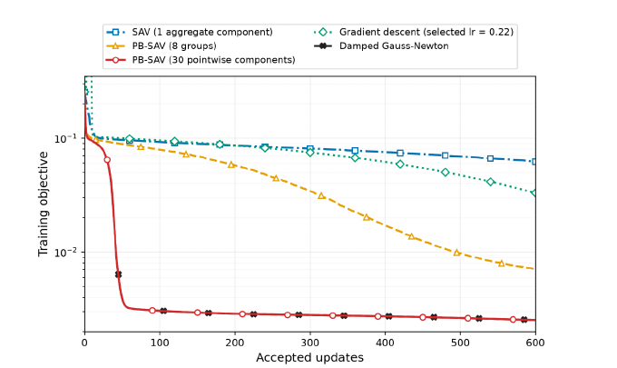
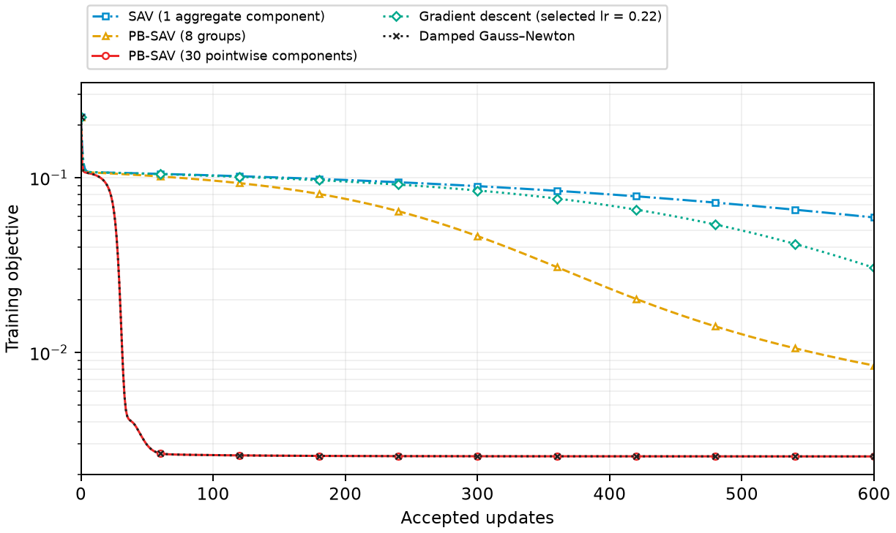
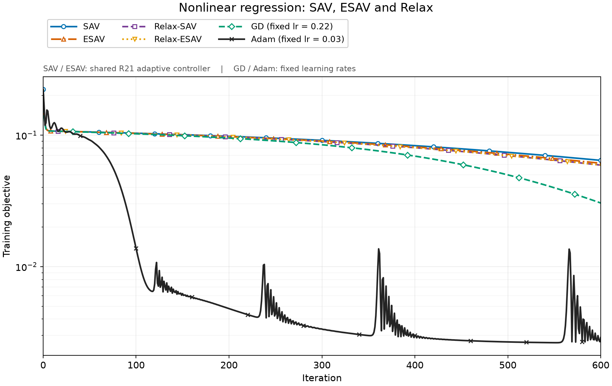
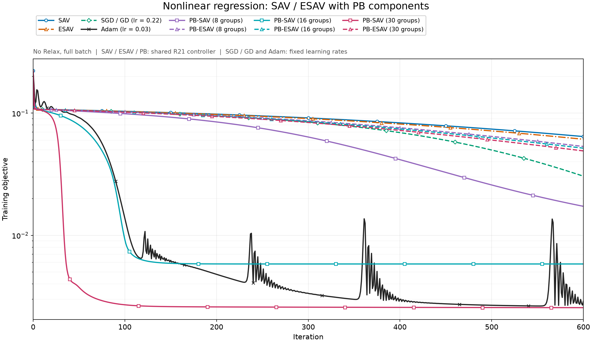

# 学习率策略的优化记录

2026-10-30。记录非线性回归最终采用的共同设置、学习率策略和已完成结果。

## 目标与共同参数

建立与 Figure 3 曲线形态相符、经用户验收的基线，并在同一学习率规则下比较 SAV 与现行 ESAV。这里的控制器是项目采用方案，不认定为论文作者未公开实现的精确复现。

$$
f_\theta(x)=\sum_{j=1}^{50}c_j\tanh(a_jx+b_j)+b_0,
\qquad E(\theta)=\frac1{2N}\sum_{k=1}^N(f_\theta(x_k)-y_k)^2,
\qquad N=30.
$$

| 项目 | 共同设置 |
| --- | --- |
| 数据 | $x_k=(k-1)/29$，$y_k=\sin(2\pi x_k)+0.1\epsilon_k$ |
| 噪声 | NumPy `RandomState(42)`，$\epsilon_k\sim\mathcal N(0,1)$ |
| 初始化 | Torch generator 42，$a_j=0.72z_j$，$b_j=-a_j/2$，$c_j=w_j/\sqrt{50}$，$b_0=0$；依次抽取 $z,w\sim\mathcal N(0,I)$ |
| 优化变量 | 全部 151 个参数独立训练，初始化后不绑定 $a,b$ |
| PB 分组 | NumPy `RandomState(42)` 排列，反复二分最大组；$m=8,16,30$ |
| 精度与预算 | CPU、float64、4 线程、600 次接受更新；含第 0 步 |
| 能量分组 | $E_i=(2N)^{-1}\sum_{k\in\mathcal I_i}(f_\theta(x_k)-y_k)^2$ |
| SAV shift | $C=10^{-10}$，$C_i=C/m$ |
| GD | 全批量，固定 $\eta=0.22$ |
| Adam | 固定 $\eta=0.03$，$\beta=(0.9,0.999)$，$\varepsilon=10^{-8}$，无权重衰减 |

初始目标值 $E^0=0.22254372737375322$。数据、初值拼接后的 SHA256：
`163089e48357b9a8ee996fd63963dc883d1ebd931f1a3815f510f294615075fe`。

## 最终学习率策略

令 $J_n$ 为样本残差对参数的一阶 Jacobian，$g_n=\nabla E(\theta_n)$，

$$
G_n=\frac1N J_n^\top J_n,\qquad
\Delta\theta_n=-\eta_n\xi_n(I+\eta_n B_n)^{-1}g_n.
$$

各方法沿用自己的辅助变量与 $B_n$，不更改递推：

| 方法（含对应 Relax） | $\xi_n$ | $B_n$ |
| --- | --- | --- |
| SAV | $q_n/\sqrt{E_n+C}$ | $g_ng_n^\top/[2(E_n+C)]$ |
| PB-SAV | $q_n/\sqrt{E_n+C}$ | $\sum_i g_{i,n}g_{i,n}^\top/[2(E_{i,n}+C_i)]$ |
| ESAV | $\exp(\log r_n-E_n/(4E^0))$ | $0$ |
| PB-ESAV | $\exp(\log r_n-E_n/(4E^0))$ | $\sum_i\exp(2\log r_{i,n}-E_{i,n}/(2E_i^0))g_{i,n}g_{i,n}^\top/(4E_i^0)$ |

$g_{i,n}=\nabla E_i(\theta_n)$，$E^0,E_i^0$ 冻结。PB-ESAV 沿用既有实现对浮点下溢为零的分量比值取 `float64.tiny` 的规则。Relax 只按既有规则修正辅助状态；控制器不变。

所有辅助变量方法使用同一个控制器、同一套常数：

$$
t_n=\operatorname{clip}\!\left(\frac{\operatorname{tr}B_n}{\operatorname{tr}G_n},0,1\right),
\qquad
\bar\eta_n=\operatorname{clip}\!\left(
\frac{0.5+0.5t_n}{\max\{\lambda_{\max}(G_n-2B_n),10^{-12}\}},10^{-6},100\right).
$$

$$
\eta_n^{\mathrm{trial}}=
\begin{cases}
\min\{1,\bar\eta_0\},&n=0,\\
\min\{1.1\eta_{n-1},\bar\eta_n,100\},&n\ge1.
\end{cases}
$$

以当前试探步重新计算 $\Delta\theta_n$，接受条件为

$$
E(\theta_n+\Delta\theta_n)
\le E(\theta_n)+10^{-4}g_n^\top\Delta\theta_n.
$$

拒绝则回滚参数与辅助状态，令 $\eta\leftarrow\max(\eta/2,10^{-6})$，重新计算试探步；最小步长仍失败则保留失败记录并停止。只有接受步计入 600 步。$G_n$ 只用一阶 Jacobian 构造，不计算 Hessian。同一规则作用于不同的 $B_n$ 和轨迹，实际学习率不要求相同。

## 已完成结果

图表直接引用已归档的探索实验记录，曲线未平滑。[原始 CSV、历史源码与完整探索快照](archive/learning_rate_strategy/exploration_snapshot.tar.gz)保存在压缩归档中；下方索引内的相对路径以归档中的 `fig3_reproduction/` 为基准。比较均对齐上述数据、初值和预算。图例中的 SGD / GD 指同一全批量 GD 记录。

### Figure 3 基线验收





该组 SAV、PB-SAV 使用完整 Relax。600 步目标值依次为：SAV $5.9213657\times10^{-2}$，PB-SAV 8 组 $8.4137187\times10^{-3}$，PB-SAV 30 组 $2.5386777\times10^{-3}$。GN 为归档参照，不在本次正式入口增加 GN 方法。

[验收配置](archive/learning_rate_strategy/accepted_config.json) · [验收来源](archive/learning_rate_strategy/accepted_manifest.json) · [共同策略核对](archive/learning_rate_strategy/learning_rate_audit.json)

### 基础方法与 Relax



| 方法 | Relax | $E^{600}$ |
| --- | --- | ---: |
| SAV | 否 | 0.0643270989 |
| ESAV | 否 | 0.0611495871 |
| SAV | 是 | 0.0592136570 |
| ESAV | 是 | 0.0592238552 |
| GD | — | 0.0304983310 |
| Adam | — | 0.0028921447 |

[六曲线原始 CSV、哈希与在线记录索引](archive/learning_rate_strategy/basic_comparison.json)

### PB：Relax 关闭



| 分组数 $m$ | PB-SAV $E^{600}$ | PB-ESAV $E^{600}$ |
| ---: | ---: | ---: |
| 8 | 0.0172854753 | 0.0533825629 |
| 16 | 0.0058327391 | 0.0516663160 |
| 30 | 0.0025612512 | 0.0490827231 |

PB-SAV 16 组出现有限值停滞；600 步时 $q/\sqrt{E+C}\approx3.32\times10^{-13}$，保留原始曲线。

[十曲线原始 CSV、哈希与在线记录索引](archive/learning_rate_strategy/pb_comparison.json)

## 当前结论与正式入口

建立了经用户验收的共同实验基线。由于数据和初始化也已调整，不将此前与当前结果的变化全部归因于学习率。现行 ESAV、Relax ESAV 及 PB-ESAV 在本次非线性配置下仍未超过 GD；下一步转为重新设计 ESAV，使其在当前策略下发挥作用。现行公式保留为对照。

正式非线性 SAV / ESAV / PB 方法默认采用上述控制器；`--relax` 只切换辅助状态修正。二次型、Darcy、动量方法维持原设置。示例（每次只运行一组）：

新数据文件为 `data/nonlinear_regression_r21.pt`，不覆盖旧数据。首次使用时可运行 `python -B -m problem.nonlinear_regression` 按固定配置生成。

```sh
conda activate numenv
python -B run.py --problem nonlinear_regression --method sav --m 1 --no-relax
python -B run.py --problem nonlinear_regression --method esav --m 1 --relax
python -B run.py --problem nonlinear_regression --method pb_sav --m 8 --no-relax
python -B run.py --problem nonlinear_regression --method pb_esav --m 30 --no-relax
python -B run.py --problem nonlinear_regression --method gd --m 1
python -B run.py --problem nonlinear_regression --method adam --m 1
```

### 合入验证

正式入口逐组完成 12 个配置，各 600 步，均已在线记录。按逐点误差标准 $|E_n-\widetilde E_n|\le10^{-10}+10^{-6}|\widetilde E_n|$ 对照归档曲线，全部通过。

| 核对项 | 结果 |
| --- | --- |
| 数据、初值 | 字节与输入哈希完全一致 |
| 分组与单步 | 8、16、30 组一致；16 组单步检查通过 |
| 回滚 | 38 次试探拒绝核对通过；最小学习率失败后恢复参数 |
| SAV / ESAV 系列完整目标轨迹 | 最大绝对差 $1.11\times10^{-16}$ |
| Adam 完整目标轨迹 | 最大绝对差 $1.68\times10^{-9}$；另通过 20 步原生 Adam 对照 |
| 学习率与回溯次数 | 全部通过逐点核对 |
| 保留设置 | 二次型、Darcy、非线性动量配置与迁移前一致 |

[逐项误差、12 个在线 run 与原始记录来源](learning_rate_strategy_validation.json)。本节为代码迁移验证；上文图表保留已验收的原始记录。
