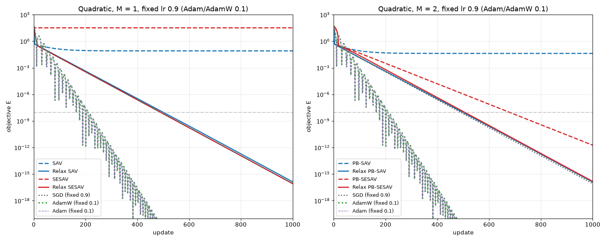
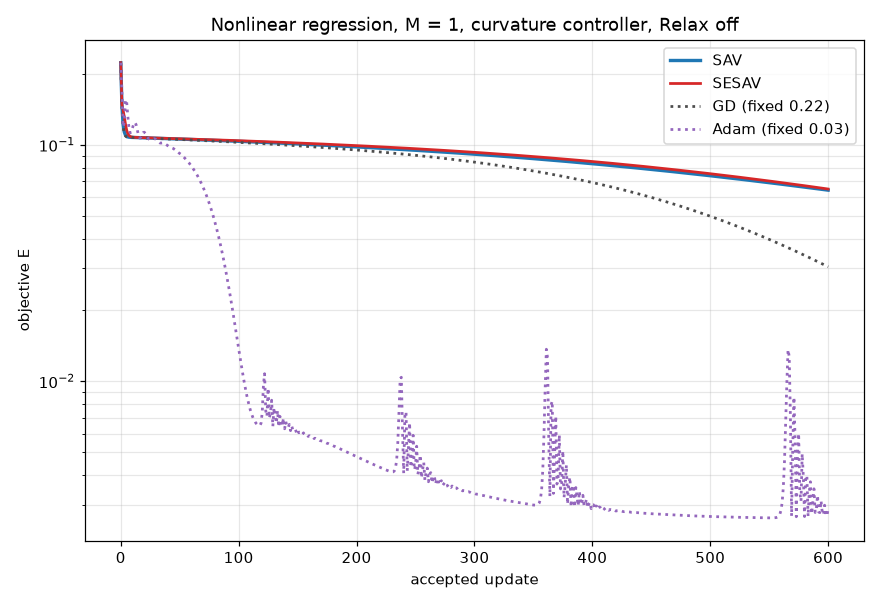
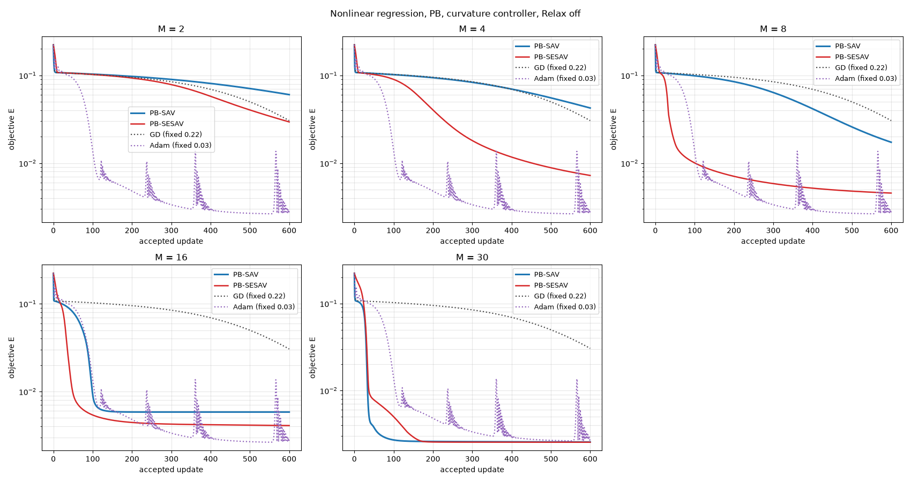

# SESAV 的数值实验

检验 [SESAV / PB-SESAV](../design/sesav.md)（$r=\exp(kE/E^0)$，$k=16$）在二次型上能否收敛，以及在非线性回归上是否接近同级 SAV。

## 共同参数

| 项目 | 二次型 | 非线性回归 |
| --- | --- | --- |
| 问题 | $f(\boldsymbol\theta)=\sum_{k=1}^{50}\theta_{2k-1}^2+\frac1{100}\sum_{k=1}^{50}\theta_{2k}^2$，$\boldsymbol\theta^0=\mathbf 1\in\mathbb R^{100}$ | $1\to50\to1$ tanh，$N=30$，见[学习率策略记录](learning_rate_strategy_optimization.md) |
| 配置 | `quadratic_fixed_lr` | `nonlinear_regression` |
| 步长 | 辅助变量方法与 SGD：固定 0.9；AdamW、Adam：固定 0.1；无线搜索 | 辅助变量方法：共同曲率控制器 + Armijo；GD 固定 0.22；Adam 固定 0.03 |
| Relax | 辅助变量方法分别关闭、开启 | 关闭 |
| 预算 | 3000 步 | 600 接受步 |
| PB 分组 | 奇、偶坐标，$M=2$ | 嵌套随机分组，$M=2,4,8,16,30$ |
| 其他 | SESAV $k=16$；SAV shift $C=10^{-10}$；CPU、float64 | 同左 |

## 二次型

| 方法 | $M$ | 达到 $10^{-8}$ 的步数 | $E^{300}$ | $E^{3000}$ |
| --- | ---: | ---: | ---: | ---: |
| [SAV](https://forge.coreweave.com/wandb/pheonizard-university-of-nottingham/NumericalScheme/runs/35f7645b22c1) | 1 | — | $8.26\times10^{-2}$ | $8.14\times10^{-2}$ |
| [SESAV](https://forge.coreweave.com/wandb/pheonizard-university-of-nottingham/NumericalScheme/runs/1ea4fd63d678) | 1 | — | $3.25\times10^{1}$ | $3.25\times10^{1}$ |
| [PB-SAV](https://forge.coreweave.com/wandb/pheonizard-university-of-nottingham/NumericalScheme/runs/9f778be5ac81) | 2 | — | $4.30\times10^{-2}$ | $4.21\times10^{-2}$ |
| [PB-SESAV](https://forge.coreweave.com/wandb/pheonizard-university-of-nottingham/NumericalScheme/runs/ed40f20bdbe9) | 2 | 677 | $2.25\times10^{-4}$ | $1.42\times10^{-35}$ |
| [Relax SAV](https://forge.coreweave.com/wandb/pheonizard-university-of-nottingham/NumericalScheme/runs/4f4ad76d6b40) | 1 | 499 | $1.20\times10^{-5}$ | $3.74\times10^{-48}$ |
| [Relax SESAV](https://forge.coreweave.com/wandb/pheonizard-university-of-nottingham/NumericalScheme/runs/78c2296d9b5a) | 1 | 488 | $9.24\times10^{-6}$ | $2.33\times10^{-48}$ |
| [Relax PB-SAV](https://forge.coreweave.com/wandb/pheonizard-university-of-nottingham/NumericalScheme/runs/41697cb402db) | 2 | 497 | $1.12\times10^{-5}$ | $3.55\times10^{-48}$ |
| [Relax PB-SESAV](https://forge.coreweave.com/wandb/pheonizard-university-of-nottingham/NumericalScheme/runs/8999fca82669) | 2 | 505 | $1.67\times10^{-5}$ | $4.21\times10^{-48}$ |
| [SGD](https://forge.coreweave.com/wandb/pheonizard-university-of-nottingham/NumericalScheme/runs/2f3ba6c0775f) | — | 488 | $9.24\times10^{-6}$ | $2.33\times10^{-48}$ |
| [AdamW](https://forge.coreweave.com/wandb/pheonizard-university-of-nottingham/NumericalScheme/runs/44ff95e5a1a4) | — | 164 | $2.25\times10^{-13}$ | $1.25\times10^{-136}$ |
| [Adam](https://forge.coreweave.com/wandb/pheonizard-university-of-nottingham/NumericalScheme/runs/a9c0ef9275a6) | — | 164 | $2.25\times10^{-13}$ | $1.25\times10^{-136}$ |

关闭 Relax 时，SAV、PB-SAV 在 $10^{-2}$ 量级停滞；SESAV 第 1 步后停在 $32.5$：首步 $\ln r$ 下降约 $\Delta t\,k\|\nabla E^0\|^2/E^0\approx57$，比值 $r/\exp(kE/E^0)$ 降至 $5\times10^{-23}$，参数不再移动。PB-SESAV 持续线性收敛，第 677 步达到 $10^{-8}$。开启 Relax 后，所有辅助变量方法持续线性收敛，与 SGD 曲线基本重合：比值保持为 1，SESAV 即固定步长 GD；学习率 0.9 时 $\mathbf B$ 的作用很小。AdamW 的 weight decay 为 0，与 Adam 逐位相同。

## 非线性回归：基础方法

| 方法 | $E^{600}$ |
| --- | ---: |
| [SAV](https://forge.coreweave.com/wandb/pheonizard-university-of-nottingham/NumericalScheme/runs/3648d291428c) | $6.433\times10^{-2}$ |
| [SESAV](https://forge.coreweave.com/wandb/pheonizard-university-of-nottingham/NumericalScheme/runs/abf45e024265) | $6.504\times10^{-2}$ |
| [GD](https://forge.coreweave.com/wandb/pheonizard-university-of-nottingham/NumericalScheme/runs/3c680d589feb) | $3.050\times10^{-2}$ |
| [Adam](https://forge.coreweave.com/wandb/pheonizard-university-of-nottingham/NumericalScheme/runs/200a3886a394) | $2.892\times10^{-3}$ |

## 非线性回归：PB

| $M$ | PB-SAV $E^{600}$ | PB-SESAV $E^{600}$ | PB-SESAV / PB-SAV |
| ---: | ---: | ---: | ---: |
| 2 | [$6.029\times10^{-2}$](https://forge.coreweave.com/wandb/pheonizard-university-of-nottingham/NumericalScheme/runs/ab698439babf) | [$2.946\times10^{-2}$](https://forge.coreweave.com/wandb/pheonizard-university-of-nottingham/NumericalScheme/runs/4f3e17e2a1c9) | 0.49 |
| 4 | [$4.245\times10^{-2}$](https://forge.coreweave.com/wandb/pheonizard-university-of-nottingham/NumericalScheme/runs/d55d737a7633) | [$7.229\times10^{-3}$](https://forge.coreweave.com/wandb/pheonizard-university-of-nottingham/NumericalScheme/runs/220e70282d3a) | 0.17 |
| 8 | [$1.729\times10^{-2}$](https://forge.coreweave.com/wandb/pheonizard-university-of-nottingham/NumericalScheme/runs/20200986643b) | [$4.554\times10^{-3}$](https://forge.coreweave.com/wandb/pheonizard-university-of-nottingham/NumericalScheme/runs/01e4e7f9986c) | 0.26 |
| 16 | [$5.833\times10^{-3}$](https://forge.coreweave.com/wandb/pheonizard-university-of-nottingham/NumericalScheme/runs/3ead38ad691c) | [$4.092\times10^{-3}$](https://forge.coreweave.com/wandb/pheonizard-university-of-nottingham/NumericalScheme/runs/1d73b080fff8) | 0.70 |
| 30 | [$2.561\times10^{-3}$](https://forge.coreweave.com/wandb/pheonizard-university-of-nottingham/NumericalScheme/runs/f4fc093afd86) | [$2.547\times10^{-3}$](https://forge.coreweave.com/wandb/pheonizard-university-of-nottingham/NumericalScheme/runs/350dc1df9f52) | 0.99 |

PB-SESAV 在 $M=2$–$16$ 低于 PB-SAV，$M=30$ 持平，并随 $M$ 改善；$M=16$ 时 PB-SAV 停在 $5.8\times10^{-3}$，PB-SESAV 继续下降。PB-SAV 的 $M=8,16,30$、SAV、GD、Adam 复用学习率策略记录中已验收的在线记录。

## 原始记录

| 内容 | 位置 |
| --- | --- |
| 在线实验 | 各结果表链接 |
| 本地记录（history.csv、config.json、summary.json） | `results/sesav/<run_id>/`，索引 `results/sesav/index.json` |
